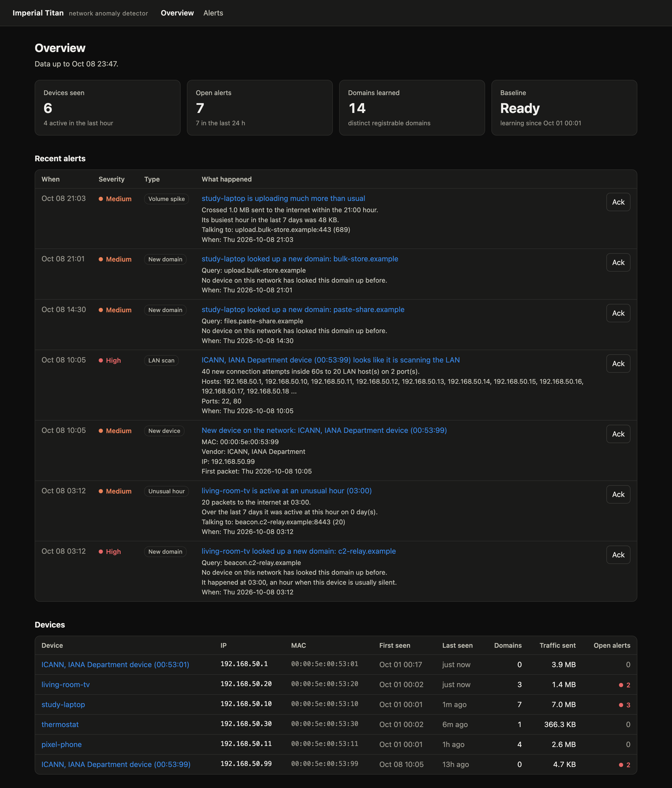
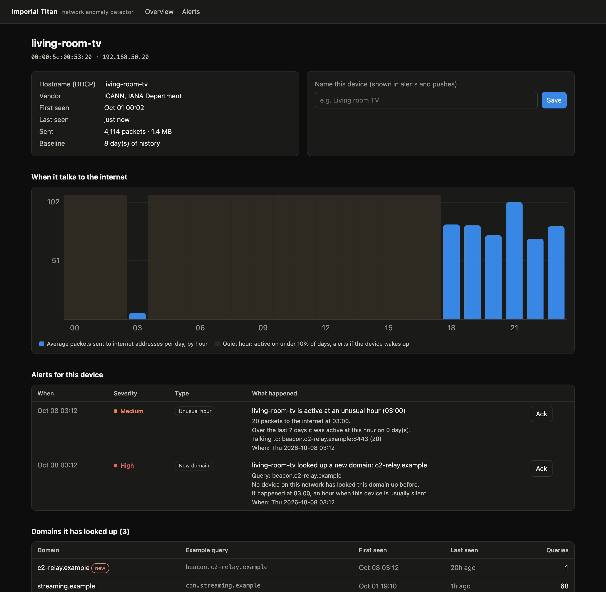

# imperial-titan-anomaly-detector

**A personal intrusion detection system for a home network. It learns what normal looks like for every device, then sends an alert to your phone when something changes.**

Author: @alex_mh · Part of the [TrifoldPathSec](https://github.com/TrifoldPathSec) home-lab portfolio

> *Imperial Titans*: god-engines that stand watch over a world and notice what moves at its edges. This one is smaller: it watches one home network and notices when a device behaves differently.



*Every MAC address, IP and domain in the screenshots and demo comes from documentation-only ranges (RFC 7042, RFC 5737, `.example`). See [Demo data](#demo-data).*

---

## What it does

- **Captures** packets with Scapy, either live from an interface or from pcap/pcapng files.
- **Learns a baseline** per device: which domains it looks up, which hours of the day it talks to the internet, how much it usually sends, and who it talks to.
- **Alerts** when behaviour departs from that baseline:

| Detector | Fires when | Severity |
|---|---|---|
| `new_device` | a MAC address never seen before appears | medium |
| `new_dns` | a device looks up a domain it has never looked up before | low if other devices already use it, medium if it's new to the whole network, raised one level at an unusual hour |
| `unusual_hour` | a device sends 20+ packets to the internet during an hour it is active on fewer than 10% of days (the smart TV at 3 am) | medium |
| `volume_spike` | a device sends more in one hour than mean + 4σ of its history (and 3× its busiest hour) | medium |
| `lan_scan` | a device opens new TCP connections to 40+ LAN host/port pairs within 60 s | high |

- **Stores** everything in SQLite (WAL mode, so the dashboard reads while the sensor writes).
- **Shows** it in a Flask dashboard: devices, each device's hour-of-day profile, every domain it has looked up, its top destinations with the DNS name that resolved to them, and alerts you can acknowledge.
- **Pushes** medium and high alerts to your phone with [ntfy](https://ntfy.sh). Pushes are rate-limited, so an alert storm doesn't flood the phone.



## How the baseline works

1. **Network learning window** (`TITAN_LEARNING_HOURS`, default 72 h from the first packet): everything gets recorded, and no baseline alerts fire. This keeps a fresh install from alerting on every device and domain at once.
2. **Device grace period** (`TITAN_DEVICE_GRACE_HOURS`, default 24 h): a device that joins after learning raises a `new_device` alert. Its own new-domain alerts then wait until it has had a day to settle.
3. **History-based checks** (`unusual_hour`, `volume_spike`) need at least `TITAN_MIN_BASELINE_DAYS` (3) days of history for that device. They compare today against previous days only.
4. **Domains are reduced to the registrable domain**: `img-03.cdn.example.co.uk` becomes `example.co.uk`. A device that rotates subdomains is not "new" every time.
5. **All time comes from packet timestamps**, never the wall clock. A pcap from last week is judged exactly as it would have been live.

`lan_scan` needs no baseline, so it is active from the first packet.

## What a Mac on Wi-Fi can and can't see

This matters more than any detector. A switched or Wi-Fi network only delivers your machine's own unicast traffic plus broadcast and multicast. On its own, the sensor:

| Sees | Doesn't see |
|---|---|
| Every device that joins (ARP, DHCP, mDNS broadcasts), including its DHCP hostname | Other devices' DNS lookups and connections (the smart TV's 3 am traffic) |
| All of the Mac's own DNS and connections | Anything sent over a VPN tunnel interface, unless you capture that interface |
| LAN scans aimed at the Mac | |

So `new_device` covers the whole network from day one, and the other detectors cover the Mac itself. To watch every device, give the sensor that traffic:

- **pcap ingest** (supported now): capture on a router, a mirror/SPAN port or a Hak5 Pager, then run `python -m titan ingest file.pcap`.
- **Mirror port**: plug the sensor into a managed switch's SPAN port and capture live on that interface.
- **Sensor as the network's DNS server** (planned): point the router's DHCP DNS setting at the sensor, so every device's lookups pass through it.

ARP spoofing would also work, but it disrupts the network it is meant to protect, so this project doesn't do it.

## Quick start

```bash
git clone https://github.com/TrifoldPathSec/imperial-titan-anomaly-detector.git
cd imperial-titan-anomaly-detector
python3 -m venv .venv && .venv/bin/pip install -r requirements-dev.txt
```

### 1. Try the demo (no root, no real traffic)

```bash
.venv/bin/python -m titan demo
.venv/bin/python -m titan --db samples/demo.db dashboard
```

Open http://127.0.0.1:5099. The demo builds a synthetic week (36k packets) with a laptop, a phone, a smart TV and a thermostat. On day 8 it plants four incidents, and the detector raises 7 alerts with no false positives on the normal days:

| Time | Planted incident | Alerts |
|---|---|---|
| 03:12 | TV beacons to `beacon.c2-relay.example` | new_dns (high), unusual_hour |
| 10:05 | unknown device joins and sweeps ports 22/80 | new_device, lan_scan (high) |
| 14:30 | laptop visits a never-seen paste site | new_dns |
| 21:00 | laptop uploads ~3 MB (busiest hour so far: 48 KB) | new_dns, volume_spike |

### 2. Set up phone notifications

```bash
.venv/bin/python -m titan init
```

This creates the database and a git-ignored `.env` with a random ntfy topic. Install the **ntfy** app ([iOS and Android](https://docs.ntfy.sh/subscribe/phone/)), subscribe to that topic, then:

```bash
.venv/bin/python -m titan notify-test
```

On the public ntfy.sh server, anyone who knows a topic name can read it. The random topic name is the secret, so don't share it. For more privacy, set `NTFY_SERVER` to a self-hosted ntfy and add `NTFY_TOKEN`.

### 3. Capture live

Capturing needs root on macOS (`/dev/bpf*`). Run this in Terminal.app:

```bash
sudo .venv/bin/python -m titan capture -i en0
```

Promiscuous mode is off by default: macOS refuses it on Wi-Fi, and on Wi-Fi it would add nothing. On a wired mirror port, add `--promisc`.

Under sudo, the database is handed back to your user, so the dashboard runs without root:

```bash
.venv/bin/python -m titan dashboard
.venv/bin/python -m titan status
```

### 4. Ingest captures from elsewhere

```bash
.venv/bin/python -m titan ingest router-capture.pcap            # dashboard only
.venv/bin/python -m titan ingest router-capture.pcap --push     # also push alerts
```

## Configuration

All settings are environment variables, or lines in `.env`:

| Variable | Default | Meaning |
|---|---|---|
| `TITAN_DB` | `data/titan.db` | SQLite database |
| `TITAN_LEARNING_HOURS` | 72 | network-wide learning window |
| `TITAN_DEVICE_GRACE_HOURS` | 24 | quiet period for a new device's domains |
| `TITAN_MIN_BASELINE_DAYS` | 3 | history needed for hour/volume checks |
| `TITAN_RARE_HOUR_RATIO` | 0.10 | "quiet hour" = active on fewer than this share of days |
| `TITAN_RARE_HOUR_MIN_PACKETS` | 20 | packets before an unusual-hour alert |
| `TITAN_SPIKE_SIGMA` / `TITAN_SPIKE_MIN_BYTES` | 4 / 50 MB | volume spike threshold |
| `TITAN_FANOUT_TARGETS` / `TITAN_FANOUT_WINDOW` | 40 / 60 s | LAN scan threshold |
| `TITAN_IGNORE_DOMAINS` | – | extra comma-separated suffixes that never alert |
| `NTFY_SERVER` / `NTFY_TOPIC` / `NTFY_TOKEN` | ntfy.sh / – / – | push target |
| `TITAN_PUSH_MIN_SEVERITY` | medium | lowest severity that is pushed |
| `TITAN_PUSH_PER_10MIN` | 10 | push rate limit |
| `TITAN_DASHBOARD_URL` | – | link opened when you tap a push |

The dashboard has no login. It binds to 127.0.0.1 by default and refuses cross-origin POSTs. Exposing it with `--host 0.0.0.0` prints a warning.

## Layout

```
titan/
  packets.py    Scapy packet -> flat Observation (ARP, DHCP hostname, DNS query/answers, flow)
  engine.py     baselines + the five detectors, batched SQLite writes
  domains.py    registrable-domain reduction
  db.py         schema (devices, device_domains, activity, destinations, alerts)
  notify.py     ntfy pushes on a background thread, with a rate limit
  capture.py    live sniff and pcap ingest
  dashboard.py  Flask app + templates/ + static/
  synth.py      synthetic demo pcap
  cli.py        python -m titan {init,capture,ingest,dashboard,notify-test,status,demo}
tests/          17 tests: parsing, every detector, learning/grace logic, notifier, dashboard
```

```bash
.venv/bin/python -m pytest -q
```

## Demo data

The demo and the tests use only reserved values: MACs from the IANA documentation block `00:00:5e:00:53:xx` (RFC 7042, which is why the vendor shows as "ICANN, IANA Department"), internet addresses from `192.0.2.0/24`, `198.51.100.0/24` and `203.0.113.0/24` (RFC 5737), and domains under `.example` (RFC 2606). Real captures and databases are git-ignored.

## Limitations

- Visibility depends on where the sensor sits (see above).
- Phones with randomized ("private") Wi-Fi addresses can show up as new devices when they rotate their MAC. The dashboard flags randomized MACs.
- DNS over HTTPS/TLS hides lookups from the `new_dns` detector. Connections still show up by IP in the destinations table.
- IPv6 traffic is recorded, but the hour/volume baselines are built from what the sensor sees, so dual-stack devices may be split across addresses.

## Roadmap

- Run the sensor as a launchd service so it survives reboots
- DNS-forwarder mode, so the sensor sees every device's lookups
- Wazuh integration (alerts as JSON log lines for the existing lab)
- Per-device "trusted" toggle and alert snoozing

## License

MIT © 2026 TrifoldPathSec (@alex_mh)
